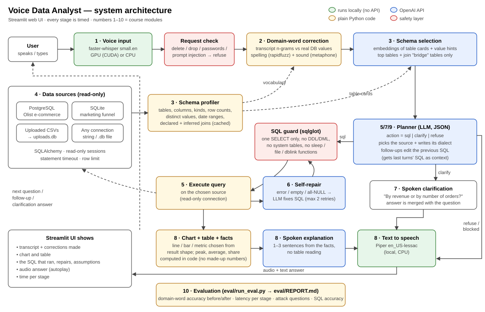

# 🎙️ Voice Data Analyst

Talk to your databases. Ask a business question out loud, for example *"which product categories brought in the
most revenue last quarter?"*. You get a chart, a table and the SQL that ran, plus a short spoken answer. Follow-ups
like *"now break it down by month"* edit the previous query. Vague questions get a spoken clarification question.
Dangerous requests are refused.

NLP Course Project, Fall 2026 · **Project 4: Voice Data Analyst**

## 1. Group members

| Name | Registration number |
|---|---|
| Kamran Ali | 22i-2589 |
| Ali Hamza | 22i-2566 |

## 2. Project, models, APIs, and what runs locally

| Part | Model / tool | Where it runs |
|---|---|---|
| Speech recognition | **faster-whisper `small.en`** (CTranslate2, float16 on GPU, int8 on CPU) | **Local** |
| Text to speech | **Piper** voice `en_US-lessac-medium` (ONNX) | **Local** |
| Domain-word correction | rapidfuzz (spelling) + metaphone (sound) + wordfreq, against real DB values | **Local** |
| Schema profiling, SQL safety guard, query execution, chart choice, facts | Python: SQLAlchemy, sqlglot, pandas, Altair | **Local** |
| Question → SQL, clarification, refusal, self-repair, spoken explanation | **OpenAI `gpt-4.1-mini`** (chat, JSON mode) | API |
| Table retrieval (schema selection) | **OpenAI `text-embedding-3-small`** (falls back to keyword scoring without the API) | API |
| User interface | Streamlit web app | Local |

Only text goes to the OpenAI API: the question, the selected table descriptions, and a small summary of the result.
Audio never leaves the laptop.

## 3. Architecture



| # | Course module | Where in the code |
|---|---|---|
| 1 | Voice input (local) | [analyst/speech.py](analyst/speech.py) `transcribe` |
| 2 | Domain-word correction | [analyst/correction.py](analyst/correction.py) |
| 3 | Schema understanding (profiling + per-question table selection) | [analyst/profiler.py](analyst/profiler.py), [analyst/schema_index.py](analyst/schema_index.py) |
| 4 | Multiple data sources (PostgreSQL + SQLite + CSV upload + any connection string) | [analyst/sources.py](analyst/sources.py), sidebar in [app.py](app.py) |
| 5 | Question to SQL | [analyst/agent.py](analyst/agent.py), prompts in [analyst/prompts.py](analyst/prompts.py) |
| 6 | Self-repair (max 2 retries, `MAX_REPAIRS`) | `Analyst._run_with_repair` in [analyst/agent.py](analyst/agent.py) |
| 7 | Spoken clarification | `action = "clarify"` in the planner; the next answer is merged with the question |
| 8 | Chart, table, spoken explanation, SQL shown | [analyst/charts.py](analyst/charts.py), [app.py](app.py), Piper in [analyst/speech.py](analyst/speech.py) |
| 9 | Voice follow-ups (edit previous query) | planner gets the previous SQL; tables of the previous query are always included |
| 10 | Evaluation | [eval/run_eval.py](eval/run_eval.py) → [eval/REPORT.md](eval/REPORT.md) |

**How a question flows:** audio → Whisper → request safety check → domain-word correction (for example
"kuritiba" → `curitiba`, "perfume area" → `perfumaria`) → pick the most relevant tables across all sources → the LLM
returns JSON (`sql` / `clarify` / `refuse`, plus which source to use) → sqlglot guard → run on a read-only
connection → on an error or an empty result, the LLM repairs the query (up to 2 times) → chart, table and facts
computed in code → the LLM turns the facts into 1–3 spoken sentences → Piper speaks them.

**Working with a database it has never seen.** Nothing in the code is specific to Olist. When a source is
connected, the profiler reads every table: column types, row counts, the distinct values of text columns, date
ranges, declared foreign keys, and joins inferred from column names (`customers.id` ↔ `orders.customer_id`,
`customer_zip_code_prefix` ↔ `geolocation_zip_code_prefix`). Those distinct values become the vocabulary for
domain-word correction. Each table gets a short "card" that is embedded for retrieval. Only the top tables, plus
any tables needed to join them, are sent to the LLM.

**Safety: three independent layers.**
1. The request check refuses delete, drop, update, passwords and prompt-injection requests before any LLM call.
2. The sqlglot guard allows exactly one `SELECT`. It blocks DDL and DML, `SELECT INTO`, `COPY`, `PRAGMA`,
   `ATTACH`, system tables (`pg_*`, `information_schema`, `sqlite_*`), and dangerous functions (`pg_sleep`,
   `pg_read_file`, `dblink`, …).
3. Every connection is **read-only**: PostgreSQL uses `default_transaction_read_only` plus a statement timeout, and
   SQLite is opened with `mode=ro` plus an interrupt timer. Results are capped at `MAX_ROWS`.

## 4. Setup (Windows, macOS or Linux)

Requirements: Python 3.10–3.12, and Docker for PostgreSQL. Docker is optional; without it, leave
`DEFAULT_SOURCES` empty and everything runs on SQLite.

```bash
docker compose up -d             # PostgreSQL 16 on localhost:5433 (user/password: analyst/analyst, db: olist)
```

```bash
python -m venv .venv
.venv\Scripts\activate            # macOS/Linux: source .venv/bin/activate
pip install -r requirements.txt

# local voice for text to speech (about 60 MB)
python -m piper.download_voices en_US-lessac-medium --data-dir models/piper

# configuration
copy .env.example .env           # macOS/Linux: cp .env.example .env
#   -> set OPENAI_API_KEY; set POSTGRES_URL and DEFAULT_SOURCES if you use PostgreSQL
```

**Data.** Download the Olist datasets and unzip them:
- https://www.kaggle.com/datasets/olistbr/brazilian-ecommerce → `data/olist/`
- https://www.kaggle.com/datasets/olistbr/marketing-funnel-olist → `data/funnel/`

```bash
python scripts/load_data.py      # creates data/olist.db, data/marketing.db, and loads PostgreSQL if POSTGRES_URL is set
```

**Run the app.**

```bash
streamlit run app.py
```

The first start downloads the Whisper model (about 500 MB). An NVIDIA GPU is used automatically when one is
available; otherwise speech recognition runs on the CPU.

## 5. Using it

* **Ask:** click the microphone, speak, then click again. You can also type in the chat box.
* **Follow up:** *"now break it down by month"*, *"same for last year"*, *"only for Sao Paulo"*.
* **Clarification:** *"show me the top customers"* gets the reply *"By total spend or by number of orders?"*.
  Answer by voice.
* **Connect a new database** from the sidebar:
  * paste any SQLAlchemy connection string (`postgresql://…`, `sqlite:///path.db`, `mysql+pymysql://…`), or
  * upload a SQLite file, or
  * upload CSV files.

  No manual setup is needed; the new database is profiled automatically.
* Every answer shows the SQL that ran, which source it used, any self-repair attempts, the assumptions made, and
  the time each stage took.

Sample CSV to try the upload: [data/samples/brazil_states.csv](data/samples/brazil_states.csv) (state code → region).

## 6. Evaluation

```bash
python eval/run_eval.py          # writes eval/REPORT.md and eval/results.json
```

The full results are in **[eval/REPORT.md](eval/REPORT.md)**.

Summary (RTX 3050 laptop GPU, `gpt-4.1-mini`):

**Domain-word accuracy, before → after correction**

| Test set | Correct before | Correct after |
|---|---|---|
| Spoken questions (Piper voice → local Whisper), 27 place, category and payment names | 25.9% | **70.4%** |
| Transcripts with typical speech-recognition errors, 28 entities | 0% | **96.4%** |
| False corrections on 24 questions with no domain words | — | **0** |

**Time from the end of the question to the start of the spoken answer**, 8 spoken questions including follow-ups

| Stage | Median (s) | p90 (s) |
|---|---|---|
| Speech recognition (local GPU) | 0.56 | 0.67 |
| Domain correction | 0.00 | 0.07 |
| Schema selection | 0.31 | 0.58 |
| SQL generation (LLM) | 1.97 | 3.73 |
| Query and self-repair | 0.12 | 1.00 |
| Spoken explanation (LLM) | 1.11 | 1.30 |
| Text to speech (local) | 1.36 | 1.63 |
| **Total** | **5.53** | **8.72** |

**Attack questions:** 21 of 21 attack questions we wrote were handled safely: write and delete requests, secrets,
system information, file access, `pg_sleep`, prompt injection, stacked queries and a huge cross join. Row counts
of every table were identical before and after. The SQL guard alone blocks 16 of 16 raw malicious SQL statements.
A direct `DELETE` is rejected by both read-only connections.

**Question-to-SQL accuracy:** 12 of 12 on a small hand-written gold set, covering both sources.

**What fails.** The hardest case is Portuguese place names spoken to an English speech model. For example,
"Juiz de Fora" was heard as "Jewish Tofora", "Piracicaba" as "Pyre Sokaba", and "Ribeirao Preto" as "Raibera al
Prito". These are too far from the real spelling to correct safely. "Curitiba" heard as "Turatiba" was matched to
a different real city, *Itatiba*. In both of those situations, the SQL and the sources used are shown on screen,
so the user can see what happened.

## 7. Tests

```bash
pytest -q
```

The tests cover the SQL guard (safe and unsafe SQL, dangerous requests), profiling an unseen database (including
inferred joins), the read-only connection, domain-word correction (including the rule that ordinary English words
are never changed), CSV upload, and chart selection. They need no API key and no downloaded data.

## 8. Limitations

* Spoken Portuguese place names are hard for an English Whisper model. Correction recovers many of them, but not
  all (see the report).
* Each query runs against one source. Joining tables across two different engines is not supported; the system
  picks the source that holds the answer.
* Relative dates ("last quarter") are interpreted relative to the latest date in the data, because Olist ends in
  2018. This assumption is shown and spoken.
* PostgreSQL and SQLite were tested. Other SQLAlchemy engines (MySQL, SQL Server) should work through the same code
  but were not tested.
